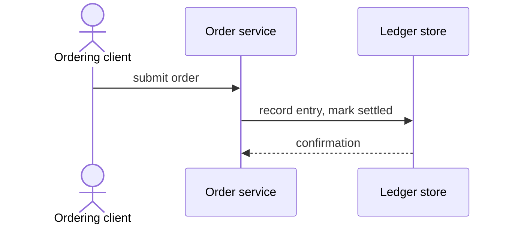
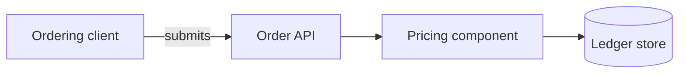
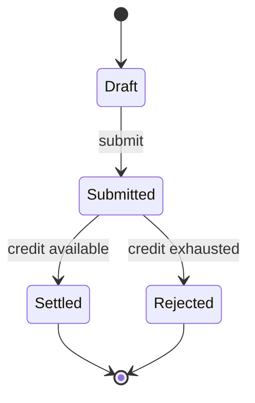

# Output Templates Reference

Complete templates for every output file the extraction produces.

## Contents

- [manifest.json](#manifestjson) · [coverage.json](#coveragejson) ·
  [00-index.md](#00-indexmd) · [glossary.md](#glossarymd) ·
  [review-workbook.csv](#review-workbookcsv) ·
  [open-questions.md (cross-domain)](#open-questionsmd-cross-domain) ·
  [coverage-report.md](#coverage-reportmd)
- Per domain: [rules.json](#domainsslugrulesjson) ·
  [business-rules.md](#domainsslugbusiness-rulesmd) ·
  [overview.md](#domainsslugoverviewmd) ·
  [features.md](#domainsslugfeaturesmd) ·
  [workflows.md](#domainsslugworkflowsmd) ·
  [validations.md](#domainsslugvalidationsmd) ·
  [integrations.md](#domainsslugintegrationsmd) ·
  [open-questions.md](#domainsslugopen-questionsmd) ·
  [diagrams.md](#domainsslugdiagramsmd) — Mermaid, read this one before writing
  any diagram
- [Optional Exports](#optional-exports): DMN decision tables, Gherkin features,
  flat CSV catalog

## manifest.json

```json
{
  "schema_version": "1.0",
  "project": {
    "name": "example-system",
    "repository_root": ".",
    "monorepo_scope": null,
    "primary_languages": ["Java", "SQL"],
    "total_source_files": 142,
    "total_loc": 28500,
    "extraction_date": "2026-08-28"
  },
  "entity_inventory": ["payment", "payment_method", "transaction_log", "account", "customer", "audit_log"],
  "domains": [
    {
      "slug": "payments",
      "name": "Payment Processing",
      "description": "Handles payment initiation, validation, and settlement",
      "source_paths": ["src/main/java/com/example/payments/", "src/main/resources/sql/payments/"],
      "owned_entities": ["payment", "payment_method", "transaction_log"],
      "dependencies": ["accounts", "customers"],
      "extraction_order": 3,
      "rule_count": 24
    }
  ],
  "shared_entities": [
    {
      "entity": "audit_log",
      "owning_domains": ["payments", "accounts"],
      "sharing_reason": "Cross-domain event logging with shared schema"
    }
  ],
  "exclusion_policy": {
    "binary": "Excluded — non-text content",
    "generated": "Excluded — requires generator marker or evidence",
    "vendored": "Excluded — third-party dependencies",
    "test": "Excluded — test fixtures and test code",
    "out_of_scope": "Excluded — outside monorepo scope or non-functional"
  }
}
```

## coverage.json

```json
{
  "schema_version": "1.0",
  "totals": {
    "total_files": 142,
    "analyzed": 118,
    "excluded": 24
  },
  "files": [
    {
      "path": "src/main/java/com/example/payments/PaymentService.java",
      "status": "analyzed",
      "domain": "payments",
      "encoding": "utf-8"
    },
    {
      "path": "src/main/resources/static/bundle.min.js",
      "status": "excluded",
      "domain": null,
      "encoding": null,
      "exclusion_reason": {
        "class": "generated",
        "detail": "Minified bundle with sourceMappingURL marker"
      }
    },
    {
      "path": "vendor/lib/third-party.jar",
      "status": "excluded",
      "domain": null,
      "encoding": null,
      "exclusion_reason": {
        "class": "binary",
        "detail": "JAR archive — binary content"
      }
    }
  ]
}
```

Coverage totals must reconcile: `total_files == analyzed + excluded`. The manifest `total_source_files` equals coverage `analyzed` count. Every regular file under the scoped root appears exactly once.

## 00-index.md

```markdown
# Business Rules Extraction — [Project Name]

## What Was Analyzed
- Repository: [path or name]
- Scope: [full repository | subtree path]
- Languages detected: [list]
- Files analyzed: [N] of [M] total ([E] excluded)
- Extraction date: [ISO date]

## How to Read This Output
- `manifest.json` — machine-readable project and domain summary
- `coverage.json` — per-file analysis status ledger
- `glossary.md` — business term definitions
- `domains/<slug>/rules.json` — canonical rule catalog per domain
- `domains/<slug>/business-rules.md` — human-readable rule documentation
- `review-workbook.csv` — SME validation spreadsheet
- `open-questions.md` — items requiring business stakeholder input

## Domains
| Domain | Rules | Description |
|--------|-------|-------------|
| [slug] | [count] | [brief description] |

## Validation
Run: `python3 scripts/validate_output.py . --repo /path/to/source`
```

## domains/&lt;slug&gt;/rules.json

Structure: `{"schema_version": "1.0", "domain": "<slug>", "rules": [...]}`. Each rule object follows the schema defined in `assets/rules.schema.json`.

## domains/&lt;slug&gt;/business-rules.md

```markdown
# Business Rules — [Domain Name]

## Overview
[Brief domain description and business purpose]

## Rules by Feature

### [Feature/Process Name]

#### BR-<slug>-001: [Rule Name]
**Statement:** [Atomic plain-language rule]
**Type:** [rule_type] | **Category:** [category]
**Confidence:** [level] — [justification]

**Acceptance Criteria:**
- Given [context]
- When [trigger]
- Then [outcome]

**Evidence:**
| File | Lines | Layer |
|------|-------|-------|
| [path] | [start–end] | [layer] |

**Related:** [linked rule IDs or "None"]
```

## domains/&lt;slug&gt;/overview.md

High-level description of the domain's business purpose, boundaries, owned entities, integration points, and key business capabilities.

## domains/&lt;slug&gt;/features.md

Enumeration of business features/capabilities within the domain. Each feature has a name, description, entry points, and links to relevant rules.

## domains/&lt;slug&gt;/workflows.md

Business process flows with steps, decision points, actors, state transitions, and error paths. Reference Mermaid diagrams in `diagrams.md`.

Where this file embeds a Mermaid block of its own, follow `references/mermaid-syntax.md`. In a `flowchart` an actor is an ordinary node — `client["Ordering client"]` — never `actor client["…"]`: `actor` is a `sequenceDiagram` keyword and is a parse error in a flowchart, which blanks the whole block.

## domains/&lt;slug&gt;/validations.md

All input and data validation logic: field-level, cross-field, and business-level validations with their enforcement points.

## domains/&lt;slug&gt;/integrations.md

External system interactions: APIs consumed/exposed, event publications/subscriptions, file exchanges, and shared database access.

## domains/&lt;slug&gt;/open-questions.md

```markdown
# Open Questions — [Domain Name]

Questions for business stakeholders. Each item cites the evidence that prompted the question.

## [Topic]
- **Question:** [What needs clarification]
- **Context:** Found in [file:lines] — [brief description of ambiguity]
- **Impact:** Affects rule(s) [BR-xxx-nnn]
```

## domains/&lt;slug&gt;/diagrams.md

Read `references/mermaid-syntax.md` before writing any block here. A parse error
blanks the entire diagram, not one line.

Three required Mermaid diagram types per domain — **as three separate blocks**.
The permitted types overlap, so a single `flowchart` may serve as the component
diagram *or* as the workflow diagram, never as both; the validator matches each
block to at most one of the three slots and reports whichever slot is left
unfilled.

1. **Sequence diagram** — key business interactions between actors/components.



2. **Component diagram** — service components and their relationships.



3. **Workflow/state diagram** — business process flow or state machine.



Three hazards these templates exist to prevent:

- **`actor` is a `sequenceDiagram` keyword only.** It declares a participant in
  the sequence block above. In the flowchart an actor is an ordinary node id
  (`client["Ordering client"]`); writing `actor client["…"]` there is a parse
  error.
- **A node id is not a declaration and cannot be reused.** Two actors in one
  flowchart means two distinct ids — `client`, `settlementBank` — not two
  `actor` lines. Redeclaring an id merges the nodes instead of failing.
- **Never write `;` in a sequence message.** Message text after `:` is read raw,
  so `;` ends the statement and orphans the remainder — use `,`, as in
  `record entry, mark settled` above. Quoting does not rescue it: even
  `orderSvc->>ledger: "record; settle"` is a parse error. Inside a *flowchart*
  label, quoting does make `;` safe: `a["priced; then settled"]`.

## glossary.md

```markdown
# Business Glossary

| Term | Definition | Source |
|------|-----------|--------|
| [Business Term] | [Plain-language definition] | [file:lines or schema reference] |
```

## review-workbook.csv

```csv
rule_id,domain,statement,question,disposition,comments
BR-payments-001,payments,"A withdrawal transaction is rejected when...",Is the limit per calendar day or rolling 24h?,,
```

Columns: `rule_id`, `domain`, `statement`, `question` (from open_questions or confidence justification), `disposition` (blank — SME fills: confirm/modify/reject), `comments` (blank — SME fills).

## open-questions.md (cross-domain)

Aggregated cross-domain questions not attributable to a single domain, plus pointers to per-domain question files.

## coverage-report.md

Human-readable rendering of `coverage.json`: summary table, per-exclusion-class counts, and any files with encoding issues or analysis notes.

## Optional Exports

### DMN-Style Decision Tables

For computation and decision rules with tabular logic. State hit policy (Unique, First, or Any) for each table.

```markdown
### [Rule Name] — Hit Policy: Unique
| Condition: [Input 1] | Condition: [Input 2] | Action: [Output] |
|-----------------------|-----------------------|-------------------|
| value | value | result |
```

### Gherkin Feature Files

For validation rules and computations. Use Scenario Outline with Examples for parameterized cases.

```gherkin
Feature: Daily Withdrawal Limit
  Scenario Outline: Withdrawal exceeding limit is rejected
    Given a customer with daily limit <limit>
    When a withdrawal of <amount> is requested
    Then the transaction result is <result>

    Examples:
      | limit | amount | result   |
      | 5000  | 4000   | approved |
      | 5000  | 6000   | rejected |
```

### Flat CSV Catalog

All rules across all domains in a single CSV for spreadsheet analysis: `id, domain, name, statement, rule_type, category, confidence, status, evidence_files, evidence_layers`.
