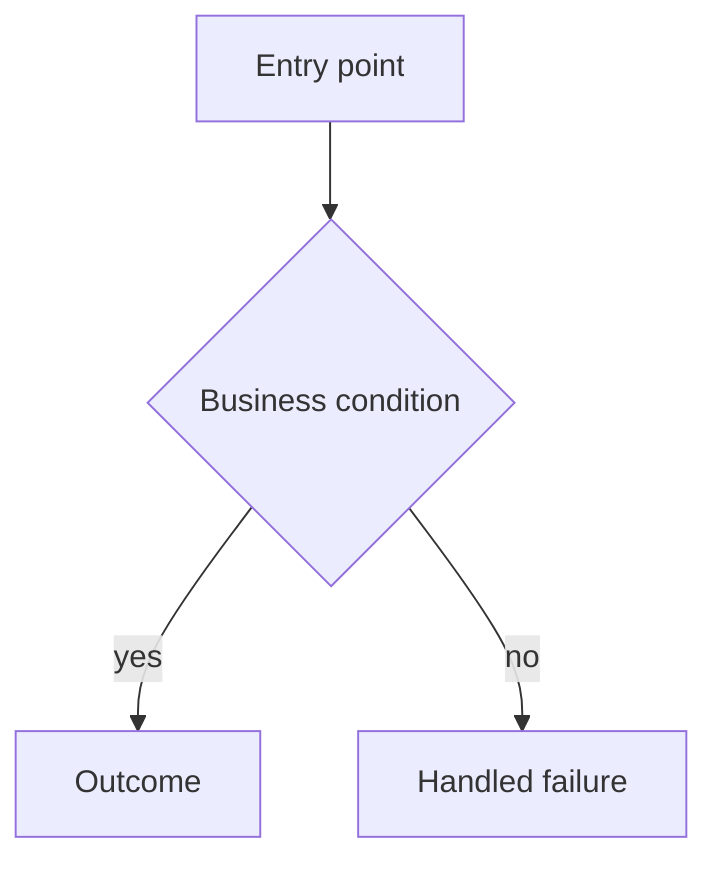

# Behavior templates

Start every file with `> Confidence: <high|medium|low> — <evidence basis and coverage>.`

## business-logic.md

Organize headings by capability/journey. For each rule: `BR-NNN`, plain-language rule, trigger, outcome, exceptions, confidence, and evidence.

Glossary: `term | plain-language definition | code identifier (if applicable) | evidence`.

Traceability appendix uses exactly:

`BR-ID | rule (plain language) | source file:line | covering TC-IDs | coverage status`

## workflows.md

For each workflow: actor, trigger, entry point, preconditions, numbered steps, state/data effects, integrations, success, failures, evidence.

## decision-logic.md

Use decision-tree tables (`condition | true path | false path | side effect | evidence`) or language-neutral pseudocode for every material branch.

## error-handling.md

Handler catalog: `boundary | handler | catches/status | response | logging | recovery/retry | evidence`. Gap table: `alias | missing handling | trigger | impact | severity | evidence`. Recovery patterns include confidence and limitations.
