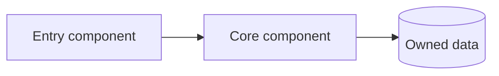
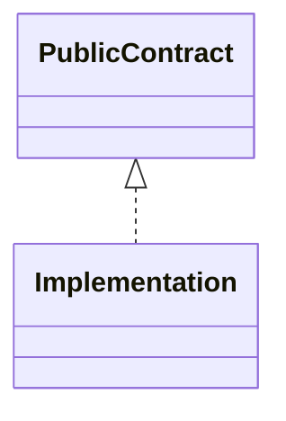
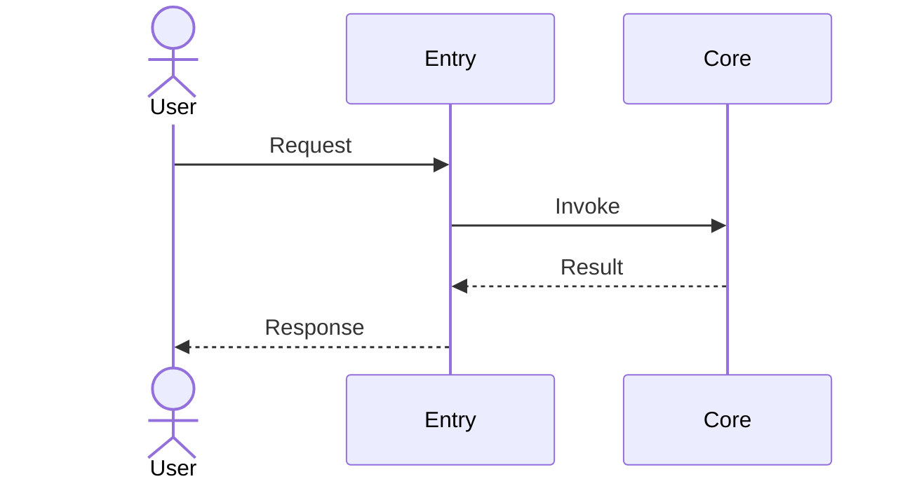
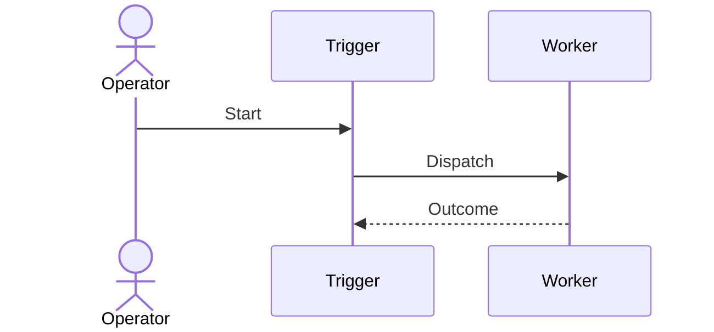
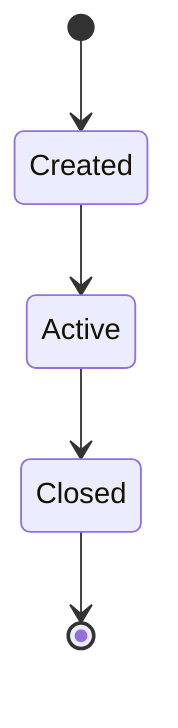
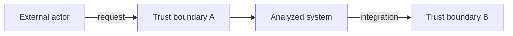

# Diagram templates

## structural/component-diagrams.md

## behavioral/sequence-diagrams.md

## architecture/system-context.md

In a flowchart an actor is an ordinary node — do not write `actor externalUser["…"]`.
`actor` is a `sequenceDiagram` keyword and is a parse error here (see the sequence
templates above for its legitimate use).

Replace placeholders with evidence-backed names. Add an evidence table after every block.
