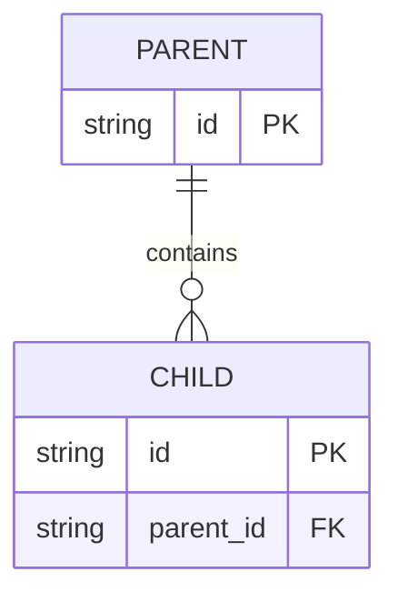

# Reference templates

## program-structure.md

Sections: Annotated source tree; Namespace/module hierarchy; Entry points; Generated/vendor/test boundaries; Component ownership.

## interfaces.md

`interface/member | full signature | visibility | async/error contract | implementation | callers | evidence`

Configuration contracts: `key/env/connection | required? | consumer | source/default | secret? | evidence`. Redact values.

## data-models.md

`entity | field | type | nullable | PK/FK | validation/constraint | owner | evidence | confidence`

## api-reference.md

`operation | method/topic | route/name | handler | authn | authz | request-forgery | side effects | evidence`.

For each operation include example redacted request and response payloads, parameters/body schema, statuses/errors, and confidence.

## modules.md

`module | CMP-ID | responsibility | exports | dependencies | dependents | shared state | coupling notes | evidence` plus cycle and cohesion notes.
