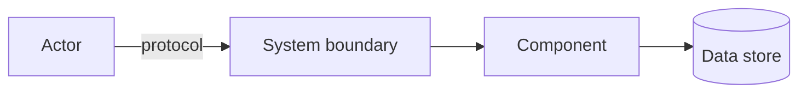
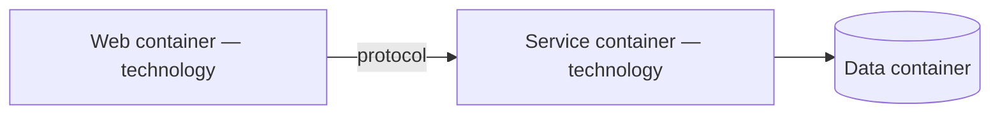
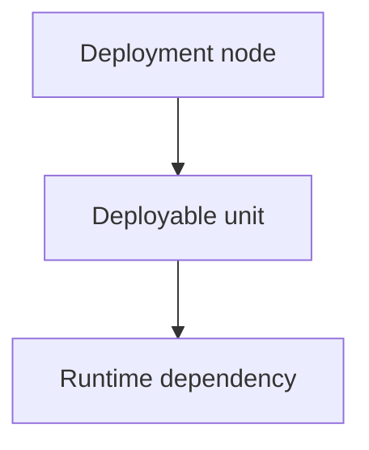

# Architecture templates

## system-overview.md

Sections: Confidence and coverage; C4 system context; Containers/deployable units; Component view; Code-level view; Deployment model; Trust boundaries; Architectural constraints; Evidence and unknowns.

System context:

Container view:

Deployment view:

## components.md

`CMP-ID | canonical key | responsibility | path/namespace | entry points | owned data | dependencies | evidence | confidence`

Add responsibility narratives and boundary ambiguities.

## dependencies.md

`from | to | sync/async | protocol/mechanism | data | authentication | messaging present? | timeout/retry/failure | evidence`

Add dependency Mermaid graph and integration failure notes.

## patterns.md

### <Pattern or anti-pattern>
- Classification: pattern | anti-pattern
- Evidence: `path:line`
- Consequence: <observed or inferred>

### ADR-lite <N>
- Decision: <decision being reconstructed>
- Choice: <observed choice>
- Rationale: <verified or inferred rationale>
- Evidence: `path:line`
- Confidence: verified | inferred | assumption
- Consequences: <trade-offs>
